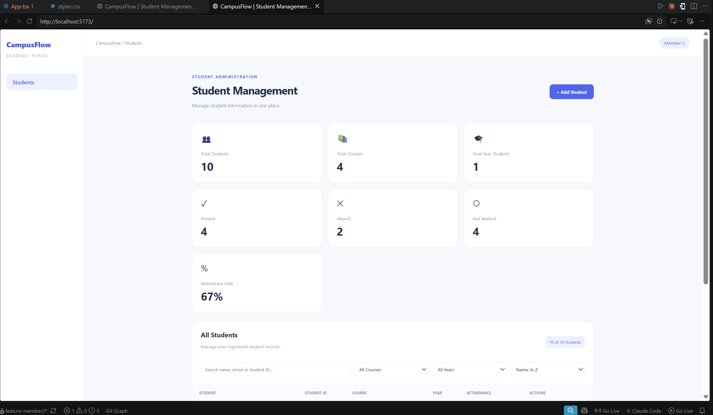
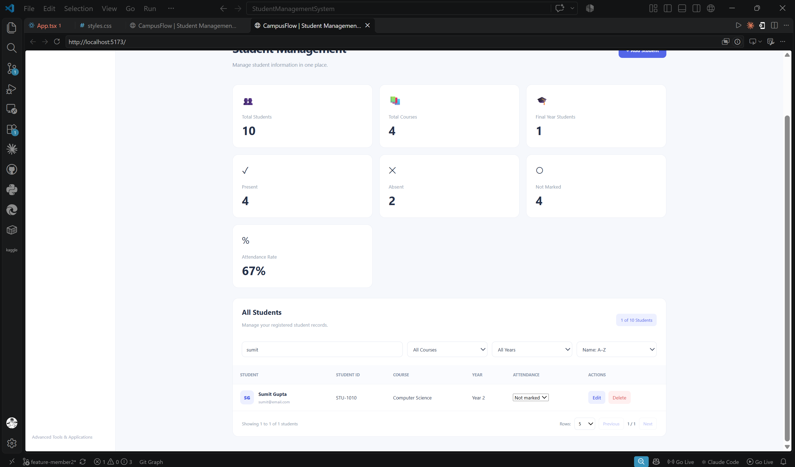
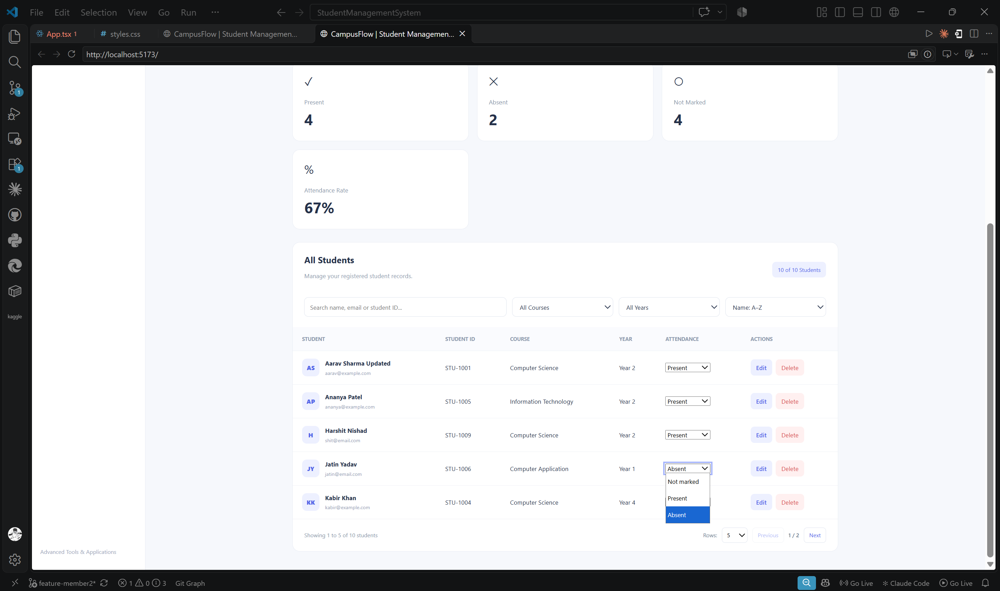

# CampusFlow — Student Management System

A modern, responsive student management application developed using **React, TypeScript, and Vite**. CampusFlow helps educational institutions organize student records, manage attendance, and monitor academic information through a centralized dashboard.

This project was developed collaboratively as part of the **Advanced Tools and Applications** course to demonstrate practical software development using **Git, GitHub, branching, pull requests, code reviews, merge operations, and Markdown documentation**.

## Project Overview

CampusFlow provides a user-friendly interface for managing student information. The system supports student registration, editing, deletion, searching, filtering, pagination, attendance management, dashboard analytics, and data import/export.

Student data is stored locally using the browser's `localStorage` API, allowing records to persist after refreshing the application without requiring a backend server.

### Project Objectives

- Develop a functional Student Management System using modern frontend technologies.
- Implement reusable React components and type-safe TypeScript interfaces.
- Simplify student registration, management, and attendance tracking.
- Provide search, filtering, pagination, and dashboard analytics.
- Demonstrate collaborative software development using Git and GitHub.
- Practice feature branching, commits, pull requests, code reviews, and merging.
- Maintain well-structured documentation using Markdown.

## Features

| Feature               | Description                                                            |
| --------------------- | ---------------------------------------------------------------------- |
| Student Registration  | Register students with their name, email, course, and academic year.   |
| Form Validation       | Validate input fields and prevent duplicate email registrations.       |
| Student Directory     | Display student information in a structured, responsive table.         |
| Edit Student          | Update existing student details using an editing form.                 |
| Delete Student        | Remove student records with confirmation.                              |
| Search                | Search students by name, email, or student ID.                         |
| Filtering             | Filter student records by course and academic year.                    |
| Sorting & Pagination  | Organize student records and navigate large datasets efficiently.      |
| Attendance Management | Mark student attendance as Present, Absent, or Not marked.             |
| Dashboard Analytics   | Display student counts, attendance statistics, and academic summaries. |
| JSON Import           | Import multiple student records from a local JSON file.                |
| CSV & JSON Export     | Download student records for local backup and reporting.               |
| Local Storage         | Preserve records across browser refreshes.                             |
| Responsive Design     | Support desktop, tablet, and mobile screen sizes.                      |

## Technologies Used

| Technology           | Purpose                                          |
| -------------------- | ------------------------------------------------ |
| React                | Component-based user interface                   |
| TypeScript           | Static typing and maintainable application logic |
| Vite                 | Development environment and production builds    |
| HTML5                | Semantic application structure                   |
| CSS3                 | Responsive styling and interface design          |
| Browser localStorage | Client-side data persistence                     |
| Git                  | Source-code version control                      |
| GitHub               | Collaboration, pull requests, and code reviews   |
| Markdown             | Project and contribution documentation           |

## Project Structure

```text
StudentManagementSystem/
├── docs/
│   └── screenshots/
│       ├── Attendance.png
│       ├── Dashboard.png
│       ├── Search-Filtering.png
│       └── Student Edit.png
├── src/
│   ├── components/
│   │   ├── EditStudentModal.tsx
│   │   ├── StudentForm.tsx
│   │   └── StudentTable.tsx
│   ├── App.tsx
│   ├── styles.css
│   ├── types/
│   │   └── student.ts
│   └── main.tsx
├── index.html
├── package.json
├── README.md
├── CONTRIBUTING.md
└── .gitignore
```

_Additional utility and import/export components may exist depending on the latest integrated version._

## Installation and Execution

### Prerequisites

Ensure the following tools are installed:

- Node.js and npm
- Git
- Visual Studio Code or another code editor

### 1. Clone the repository

```bash
git clone https://github.com/niteash/StudentManagementSystem.git
```

### 2. Navigate to the project

```bash
cd StudentManagementSystem
```

### 3. Install dependencies

```bash
npm install
```

### 4. Start the development server

```bash
npm run dev
```

Open the local URL displayed by Vite, usually:

http://localhost:5173

### 5. Check TypeScript

```bash
npm run typecheck
```

### 6. Build the application

```bash
npm run build
```

The compiled application is generated inside the `dist/` directory.

## Team Members and Contributions

This project was developed by two students using separate Git feature branches.

| Team Member       | GitHub Account                            | Role                                       | Branch            |
| ----------------- | ----------------------------------------- | ------------------------------------------ | ----------------- |
| Shwe Win Aung     | [niteash](https://github.com/niteash)     | Frontend Developer & Repository Maintainer | `feature-member1` |
| Abhishek Emmanual | [abhinsane](https://github.com/abhinsane) | Frontend Developer & Feature Contributor   | `feature-member2` |

**Roll Numbers:**

- Shwe Win Aung: `[74]`
- Abhishek Emmanual: `[3]`

### Student 1 — Shwe Win Aung

Responsible for developing the foundation and core student management functionality.

Contributions:

1. Initialized the Git repository and configured the project.
2. Developed student registration and input validation.
3. Implemented the student directory and deletion functionality.
4. Added duplicate-email prevention.
5. Developed the initial dashboard statistics.
6. Worked on JSON data import and CSV/JSON export.
7. Improved application styling and responsive design.
8. Maintained the project structure and Git workflow.

### Student 2 — Abhishek Emmanual

Responsible for advanced student management features, analytics, and documentation improvements.

Contributions:

1. Developed student editing with validation.
2. Implemented student searching, filtering, and pagination.
3. Added attendance management functionality.
4. Developed attendance statistics and dashboard analytics.
5. Improved the student table interface.
6. Updated project documentation.
7. Added application screenshots.
8. Integrated contributions through GitHub pull requests.

## 🌿 Git and GitHub Collaboration

The project followed a feature-branch workflow.

### Branches

| Branch            | Purpose                              |
| ----------------- | ------------------------------------ |
| `main`            | Integrated and reviewed project code |
| `feature-member1` | Student 1 development                |
| `feature-member2` | Student 2 development                |

### Development Workflow

1. The repository was initialized and pushed to GitHub.
2. Student 1 developed the core functionality on `feature-member1`.
3. Student 2 developed additional features on `feature-member2`.
4. Both students created meaningful commits.
5. Feature changes were submitted through GitHub pull requests.
6. The feature branches were merged into `main`.
7. The integrated project was checked using TypeScript and Vite build commands.

### Pull Requests

| Pull Request                                                       | Description                                          | Status |
| ------------------------------------------------------------------ | ---------------------------------------------------- | ------ |
| [PR #1](https://github.com/niteash/StudentManagementSystem/pull/1) | Student 1's core management features                 | Merged |
| [PR #3](https://github.com/niteash/StudentManagementSystem/pull/3) | Student 2's editing, search, and attendance features | Merged |
| [PR #4](https://github.com/niteash/StudentManagementSystem/pull/4) | Student 2's analytics and documentation updates      | Merged |

### Git History

To inspect the complete Git history:

```bash
git log --oneline --graph --all
```

To display all branches:

```bash
git branch -a
```

To view the latest commits:

```bash
git log --oneline -10
```

### Merge Conflict Resolution

The assignment also requires both members to demonstrate and resolve a Git merge conflict.

Conflict resolution evidence, including the conflicting changes, resolved file, and resolution commit, should be documented in the final PDF report and linked here once the exercise is completed.

## Application Screenshots

### Dashboard

The dashboard provides an overview of student records and attendance statistics.



### Student Editing

Students' information can be updated using the editing interface.


### Search and Filtering

The directory supports searching and filtering student records.



### Attendance Management

Student attendance can be updated and monitored using the attendance interface.



## Testing and Verification

The application can be checked using:

```bash
npm run typecheck
npm run build
```

The integrated project successfully passed TypeScript validation and a Vite production build during development.

### Functional Test Cases

| Test Case                  | Expected Result                      |
| -------------------------- | ------------------------------------ |
| Register a student         | New student appears in the directory |
| Submit invalid information | Appropriate validation message       |
| Register a duplicate email | Duplicate registration rejected      |
| Edit a student             | Updated details are saved            |
| Delete a student           | Record removed after confirmation    |
| Search a student           | Matching records displayed           |
| Filter students            | Results match selected criteria      |
| Change attendance          | Selected attendance status updated   |
| Refresh the browser        | Saved records remain available       |
| Import valid JSON          | Valid student records loaded         |
| Export records             | Downloadable data file created       |

## Data Privacy and Security

CampusFlow is an educational demonstration application.

- Student records are stored locally in the browser.
- No backend authentication or hosted database is implemented.
- Private roster files must not be committed to the public repository.
- The `.gitignore` file should exclude local private files, build artifacts, and dependencies.
- Fictional or anonymized student records should be used in public screenshots.

**Note:** Browser localStorage is not suitable for securing confidential student information in a production deployment.

## Learning Outcomes

Through this project, the team gained practical experience in:

- Collaborative development using Git and GitHub.
- Managing feature branches and commit histories.
- Creating and integrating pull requests.
- Developing reusable React components.
- Using TypeScript for type-safe frontend development.
- Implementing client-side state management and persistence.
- Testing application functionality.
- Maintaining Markdown-based technical documentation.

## Future Enhancements

Potential improvements include:

- Backend API and database integration.
- User authentication and role-based access control.
- Date-wise attendance history.
- Advanced reporting and downloadable attendance reports.
- Deployment to a hosted environment.

## Academic Information

**Project:** CampusFlow — Student Management System  
**Subject:** Advanced Tools and Applications  
**Group Size:** 2 Students  
**Project Repository:** https://github.com/niteash/StudentManagementSystem  
**Development Stack:** React + TypeScript + Vite

---

Developed collaboratively by **Shwe Win Aung and Abhishek Emmanual** for the Advanced Tools and Applications group assignment.
